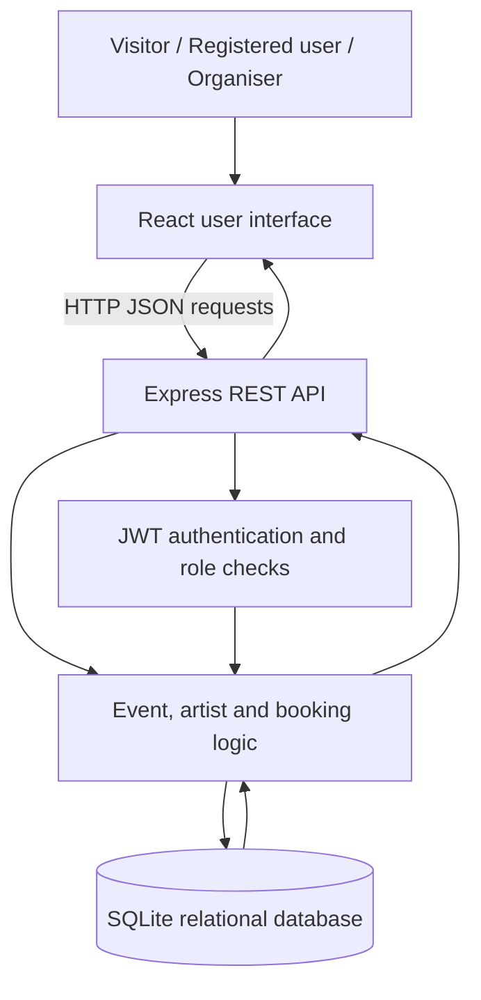
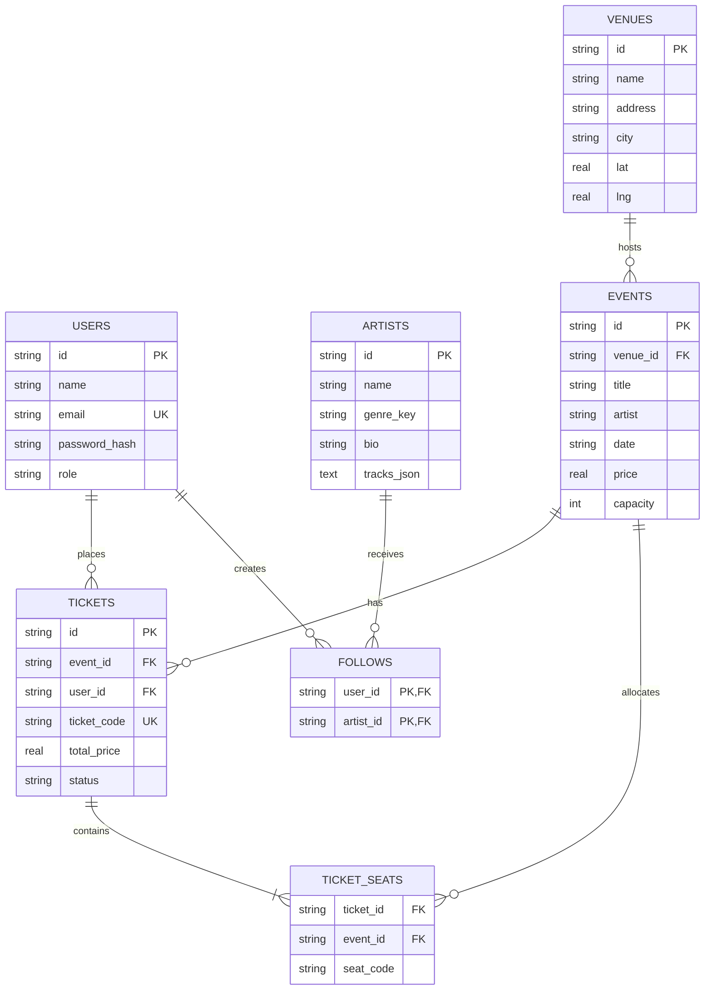
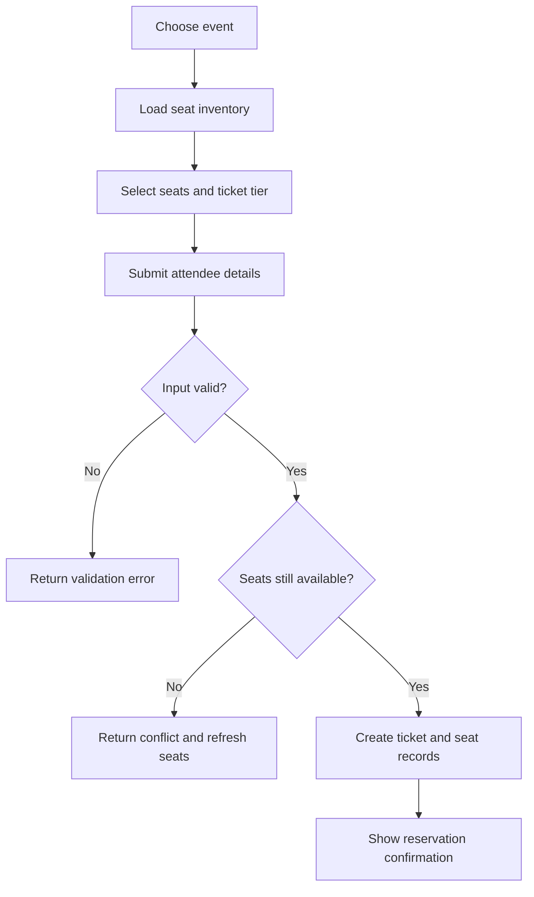

# Coursework 2 — System Design Document
## Aurelia Vinyl Live (Music-Life)

**Document purpose:** This document describes the design and proof-of-concept implementation of a UK live-music discovery and ticket-reservation website. It is written for the Coursework 2 design-document and application requirements. Replace the author, student number, module code and submission date fields before submission.

| Field | Value |
|---|---|
| Project | Aurelia Vinyl Live / Music-Life |
| Document type | System Design Document |
| Version | 1.0 |
| Author | [Your name] |
| Student ID | [Your student ID] |
| Module | [Module name/code] |
| Date | [Submission date] |

---

## 1. Introduction

### 1.1 Project overview
Aurelia Vinyl Live is a responsive web application for discovering live music events across the United Kingdom. Visitors can browse artists and events, search and filter performances, view venue locations, select seats and create a demonstration ticket reservation. Registered users can manage their account, follow artists and review their reservations. An organiser account can publish new events.

### 1.2 Problem statement
Information about live music is often distributed across artist pages, venue listings and ticketing services. This proof of concept brings event discovery, artist information, venue information and a simple reservation journey into one interface. It demonstrates how a web application can connect a client interface, a server-side API and a relational database.

### 1.3 Project objectives
- Provide a clear and responsive interface for discovering UK live-music events.
- Allow visitors to search and filter the event catalogue.
- Present artist biographies and selected tracks.
- Display venue locations on an interactive map.
- Demonstrate seat selection and server-side reservation validation.
- Support account registration, login and password hashing.
- Demonstrate role-based event publishing for organisers.
- Persist application data in a relational SQLite database.

### 1.4 Scope
The proof of concept includes event and artist browsing, authentication, artist follows, organiser event creation, seat selection and reservation records. It does not process real payments, issue legally valid tickets, send transactional email or provide a production-grade ticket resale/refund service. These are outside the scope of the coursework prototype.

## 2. Stakeholders and user roles

| Stakeholder / role | Main needs | Application permissions |
|---|---|---|
| Visitor | Explore events, artists and venues; check seat availability | Read public catalogue; create a demonstration reservation |
| Registered user | Save interests and view reservations | Login, follow/unfollow artists, view own reservations |
| Organiser / administrator | Publish performances and maintain listings | All organiser event-publishing actions; view reservation records |
| Site maintainer | Run, test and deploy the application | Configure environment, maintain database and application |

The current prototype permits a guest reservation using attendee details. When a visitor is authenticated, the reservation is also associated with their account. This is a demonstration workflow, not a payment or identity-verification system.

## 3. Functional requirements

| ID | Requirement | Priority | Proof-of-concept evidence |
|---|---|---|---|
| FR-01 | The system shall display upcoming events. | Must | Event listing loaded from `/api/events` |
| FR-02 | The system shall allow event search and genre/availability filtering. | Must | Client-side search and filter controls |
| FR-03 | The system shall display artist profiles. | Must | Artist archive loaded from `/api/artists` |
| FR-04 | Users shall be able to register and log in. | Must | `/api/auth/register`, `/api/auth/login` |
| FR-05 | Passwords shall be stored as bcrypt hashes, not plaintext. | Must | `password_hash` column |
| FR-06 | Authenticated users shall be able to follow/unfollow artists. | Should | `follows` relation and follow API |
| FR-07 | Organisers shall be able to publish events. | Must | Protected `POST /api/events` endpoint |
| FR-08 | Users shall be able to inspect seat availability. | Must | `GET /api/events/:id/seats` |
| FR-09 | Users shall be able to reserve between one and eight seats. | Must | `POST /api/tickets` with server validation |
| FR-10 | The system shall prevent a seat being reserved twice for one event. | Must | Unique database key on `(event_id, seat_code)` |
| FR-11 | Authenticated users shall be able to view their reservations. | Should | Protected `GET /api/tickets` |
| FR-12 | The system shall display UK venue locations on a map. | Should | Leaflet map and venue endpoint |
| FR-13 | The interface shall support English and Simplified Chinese. | Should | Existing language switch in client |
| FR-14 | The interface shall support dark and light themes. | Could | Existing theme controls |

## 4. Non-functional requirements

- **Usability:** navigation, event cards and booking steps should be understandable without specialist knowledge.
- **Responsive design:** layouts should adapt to desktop, tablet and mobile widths.
- **Performance:** catalogue data is served through lightweight JSON API responses; database queries use indexes for event dates and ticket ownership.
- **Security:** passwords are hashed with bcrypt; authenticated routes use signed JWTs; organiser publishing is role-protected; authentication endpoints are rate-limited; HTTP security headers are enabled.
- **Data integrity:** foreign keys connect related records and a composite unique key prevents duplicate seat allocation.
- **Maintainability:** frontend, server routes and persistence are separated into client and server folders.
- **Portability:** SQLite stores the database in a local file and does not require a separately managed database service.

## 5. Proposed architecture

The application uses a three-layer architecture:

1. **Presentation layer — React + Vite:** renders pages and controls, handles local interface state and sends HTTP requests.
2. **Application layer — Node.js + Express:** validates requests, checks authentication and roles, applies booking rules and returns JSON responses.
3. **Data layer — SQLite:** persists users, venues, artists, events, follows, tickets and reserved seats using relational tables and constraints.



### 5.1 Technology selection

| Technology | Purpose | Reason for selection |
|---|---|---|
| React 18 | Frontend interface | Component-based UI and reusable page elements |
| Vite | Frontend development/build | Fast development server and production bundling |
| CSS | Styling and responsive layout | Direct control of visual design and breakpoints |
| Node.js | Server runtime | JavaScript across client and server |
| Express | REST API | Lightweight routing and middleware |
| SQLite (`node:sqlite`) | Relational persistence | SQL database in a single file; no separate server required |
| bcryptjs | Password hashing | One-way password hashing with salt rounds |
| JSON Web Token | Session authentication | Signed short-lived bearer token for protected API calls |
| Leaflet / React Leaflet | Venue map | Interactive map with marker support |
| Git / GitHub | Version control | Source history and collaboration/deployment workflow |

SQLite is selected because the brief does not specify a database product and the project is a proof of concept. It supports SQL tables, primary keys, foreign keys, indexes and unique constraints. The project requires Node.js 22.5 or newer because it uses the built-in `node:sqlite` module.

## 6. Database design

### 6.1 Entity descriptions

- **User:** stores account identity, email, password hash and role.
- **Venue:** stores the name, postal address, city, nation and map coordinates for a performance location.
- **Artist:** stores an artist profile, genre, biography, tracks and curator note.
- **Event:** stores the performance title, artist name, date, ticket price, venue reference and capacity.
- **Follow:** resolves the many-to-many relationship between users and artists.
- **Ticket:** stores a reservation, attendee details, event snapshot, tier, prices and status. A nullable user reference associates signed-in reservations with an account.
- **TicketSeat:** stores each seat in a reservation and prevents the same seat being allocated more than once for the same event.

### 6.2 Relationships

- One venue can host many events (Venue 1 — M Event).
- One event can have many tickets (Event 1 — M Ticket).
- One user can have many tickets (User 1 — M Ticket); a guest ticket may have no user reference.
- Users and artists have a many-to-many relationship through Follow (User M — N Artist).
- One ticket contains one or more reserved seats (Ticket 1 — M TicketSeat).
- TicketSeat also references its event so that `(event_id, seat_code)` can be unique.



### 6.3 Integrity rules

- Every user has a unique email address (case-insensitive comparison).
- Every event references an existing venue.
- Every ticket references an existing event.
- A follow row must reference an existing user and artist; the pair is unique.
- Every ticket seat references an existing ticket and event.
- The pair `(event_id, seat_code)` is the primary key of `ticket_seats`, preventing duplicate seat allocation for the same event.
- Event prices must be non-negative at database level and are additionally validated by the API when an organiser creates an event.

### 6.4 Data dictionary (main attributes)

| Table | Attribute | Type | Description |
|---|---|---|---|
| users | id | TEXT PK | UUID account identifier |
| users | email | TEXT UNIQUE | Login email |
| users | password_hash | TEXT | bcrypt password hash |
| users | role | TEXT | `user` or `admin` |
| venues | id | TEXT PK | Venue identifier |
| venues | lat, lng | REAL | Map coordinates |
| artists | id | TEXT PK | Artist identifier |
| artists | tracks_json | TEXT | JSON-encoded list of tracks |
| events | id | TEXT PK | Event identifier |
| events | venue_id | TEXT FK | Venue hosting the event |
| events | date | TEXT | ISO date/time |
| events | price | REAL | Base ticket price |
| follows | user_id, artist_id | TEXT composite PK | User/artist relationship |
| tickets | id | TEXT PK | Reservation identifier |
| tickets | ticket_code | TEXT UNIQUE | Human-readable reservation code |
| tickets | user_id | TEXT FK nullable | Account placing the reservation, if signed in |
| ticket_seats | event_id, seat_code | TEXT composite PK | Unique seat allocation for an event |

## 7. Main application workflows

### 7.1 Registration and login
1. The user enters a name, email and password.
2. The API validates required fields and password length.
3. The password is hashed using bcrypt before it is stored.
4. The API returns a signed JWT and a safe user profile (never the password hash).
5. The client sends the JWT as a bearer token to protected endpoints.

### 7.2 Event publishing
1. The organiser signs in with an administrator account.
2. The client submits the event title, artist, date, venue and price.
3. The API verifies the JWT and checks the `admin` role.
4. The API validates the event and stores it with a foreign key to the selected venue.
5. The updated event appears in the public event catalogue.

### 7.3 Seat reservation
1. The visitor selects an event and requests its seat inventory.
2. The API returns seats already reserved for that event.
3. The visitor selects one to eight seats and chooses a ticket tier.
4. The server validates the event, seat format, ticket tier, attendee name and email.
5. The server checks availability and calculates the total price.
6. The ticket and its seat rows are persisted. The database uniqueness constraint provides a final duplicate-seat safeguard.
7. The API returns a reservation confirmation and reference code.



## 8. API design

| Method | Endpoint | Access | Purpose |
|---|---|---|---|
| GET | `/api/health` | Public | Health check |
| POST | `/api/auth/register` | Public | Create account |
| POST | `/api/auth/login` | Public | Authenticate account |
| GET | `/api/auth/me` | Authenticated | Return current profile |
| GET | `/api/events` | Public | List events and venue data |
| GET | `/api/events/:id/seats` | Public | Return reserved seat inventory |
| POST | `/api/events` | Admin | Publish a performance |
| GET | `/api/artists` | Public | List artist profiles and current user's follows |
| POST | `/api/artists` | Authenticated | Add artist profile |
| PATCH | `/api/artists/:id/note` | Authenticated | Update curator note |
| POST | `/api/artists/:id/follow` | Authenticated | Toggle artist follow |
| POST | `/api/tickets` | Public / optional account | Create reservation; associates signed-in user when available |
| GET | `/api/tickets` | Authenticated | List own reservations (admin can view all) |
| GET | `/api/venues` | Public | List venue locations |

API requests and responses use JSON. Error responses include a concise `error` message and appropriate HTTP status codes such as 400 (validation), 401 (authentication), 403 (authorization), 404 (not found), 409 (conflict) and 500 (unexpected server error).

## 9. User interface design

The existing interface uses a dark editorial music aesthetic with warm gold accents, serif display typography and high-contrast event imagery. The visual language is intended to evoke a live-music archive while keeping ticket discovery and booking actions clear.

Main interface areas include:
- Home / event discovery with upcoming performances.
- Search and genre/availability filters.
- Artist archive and artist profile details.
- Venue map with UK locations.
- Event details and interactive 10 × 10 seat selector.
- Reservation form and confirmation.
- Account sign-in / registration and ticket list.
- Organiser event-publishing interface.

Responsive behaviour should preserve the primary navigation and booking controls on narrow screens, stack card layouts vertically and keep forms usable without horizontal scrolling. The English / Simplified Chinese language switch and dark / light theme controls are part of the existing client experience.

## 10. Security and privacy considerations

- Passwords are stored as bcrypt hashes; plaintext passwords are not written to the database.
- JWTs are signed using `JWT_SECRET`; a strong environment-specific secret must be configured before deployment.
- Organiser event publishing requires both a valid token and administrator role.
- Authentication endpoints use rate limiting to reduce repeated login attempts.
- Helmet adds common HTTP security headers.
- Request fields are length-limited and validated on the server.
- The database uses foreign-key constraints and a unique seat key to preserve relationships and prevent duplicate allocation.
- The prototype should not collect payment card data. Real payment handling would require a payment provider and verified server-side webhooks.
- Before public use, add a privacy notice, retention/deletion process, HTTPS, secure secret management, backups and a review of UK GDPR requirements.

## 11. Testing plan

The following tests should be carried out and recorded before submission. Add the actual execution date, environment and result after running them on your machine.

| Test ID | Test scenario | Expected result |
|---|---|---|
| T-01 | Open the home page | Main interface loads and event content is visible |
| T-02 | Search for an artist or event title | Matching events are shown |
| T-03 | Filter events by genre | Only matching genre events remain |
| T-04 | Register with valid details | Account is created and a token is returned |
| T-05 | Register with an existing email | API returns HTTP 409 |
| T-06 | Register with a password shorter than 8 characters | API returns HTTP 400 |
| T-07 | Log in with an incorrect password | API returns HTTP 401 |
| T-08 | Request `/api/auth/me` without a token | API returns HTTP 401 |
| T-09 | Attempt to publish an event as a normal user | API returns HTTP 403 |
| T-10 | Publish an event as an organiser with valid data | Event is saved and appears in event listing |
| T-11 | Request seat inventory for a valid event | Reserved seats are returned |
| T-12 | Reserve one available seat | Reservation is created and confirmation is returned |
| T-13 | Attempt to reserve the same event seat again | API returns HTTP 409; duplicate seat is not stored |
| T-14 | Submit more than eight seats | API returns HTTP 400 |
| T-15 | Follow an artist while signed in | Follow relation is stored and reflected in profile data |
| T-16 | View reservations while signed in | Only the user's reservations are returned (admin sees all) |
| T-17 | Refresh the server after creating records | SQLite data remains available |
| T-18 | View the site on a mobile-width screen | Content remains readable and usable |

## 12. Deployment and operation

### Local development

Requirements: Node.js 22.5 or newer and npm 10 or newer.

```bash
npm install
cp .env.example .env
# Set a long random JWT_SECRET in .env
npm run dev
```

The Vite client is available at `http://localhost:5173`; the Express API is available at `http://localhost:4000`.

### Production build

```bash
npm run build
npm start
```

The Express application serves the compiled frontend from `client/dist`. The SQLite database is created automatically at `server/data/musiclife.sqlite` on first start. Keep this directory on a persistent disk when deploying; ephemeral hosting filesystems can lose the database after a restart or redeploy.

### Demo accounts

| Role | Email | Password |
|---|---|---|
| Organiser | `admin@aurelia.uk` | `Aurelia2026!` |
| Guest | `guest@aurelia.uk` | `Vinyl2026!` |

These are coursework demonstration accounts. Change or remove them before any public deployment.

## 13. Limitations and future improvements

Current limitations:
- Reservations are demonstration records; no payment is taken.
- No email confirmation or QR-code ticket validation is provided.
- Artist and event imagery is a limited demonstration collection.
- The demo administrator account is seeded for assessment convenience.
- The prototype is intended for a single application instance with a persistent SQLite file.

Future improvements:
- Add a payment gateway with verified webhook processing.
- Add email confirmation and downloadable ticket QR codes.
- Add cancellation/refund workflows and reservation expiry.
- Add audit logging and more granular organiser permissions.
- Add automated integration tests and accessibility testing.
- Migrate to PostgreSQL if the application requires multiple concurrent server instances.

## 14. Conclusion

Aurelia Vinyl Live demonstrates a full-stack web application with a React presentation layer, Express API and relational SQLite persistence. Its key coursework evidence is the separation of application layers, relational data model, authentication and role checks, event publishing, artist follows, and a reservation workflow with database-level seat uniqueness. The implementation is a proof of concept and intentionally does not claim to be a production payment platform.

---

## Submission completion checklist

- [ ] Replace all author and module placeholders on the cover page.
- [ ] Add screenshots of the actual running home, event, artist, map, seat selection and confirmation screens.
- [ ] Add a screenshot of the SQLite schema / database browser showing the tables and sample rows.
- [ ] Run every test in Section 11 and record Pass / Fail with evidence.
- [ ] Confirm that the deployed URL works from a separate browser/device.
- [ ] Check the final word count and formatting against the module's submission instructions.
- [ ] Ensure the final document accurately describes the submitted code and does not claim unimplemented features.
